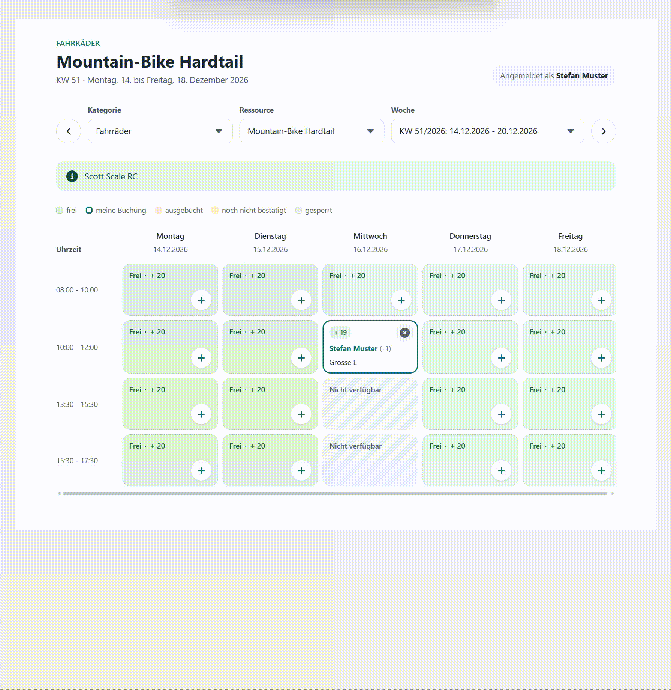
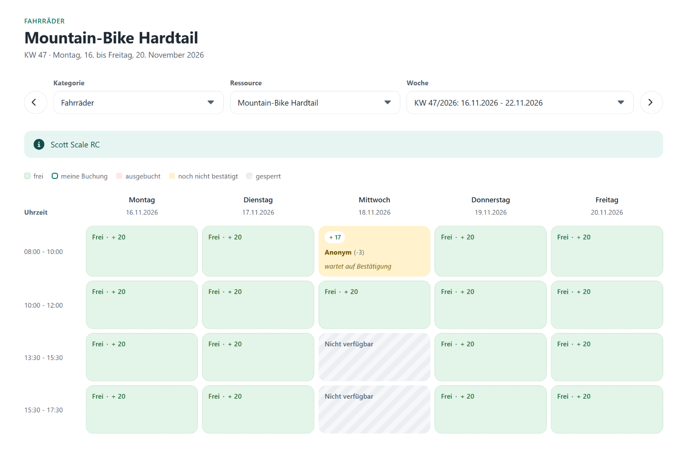
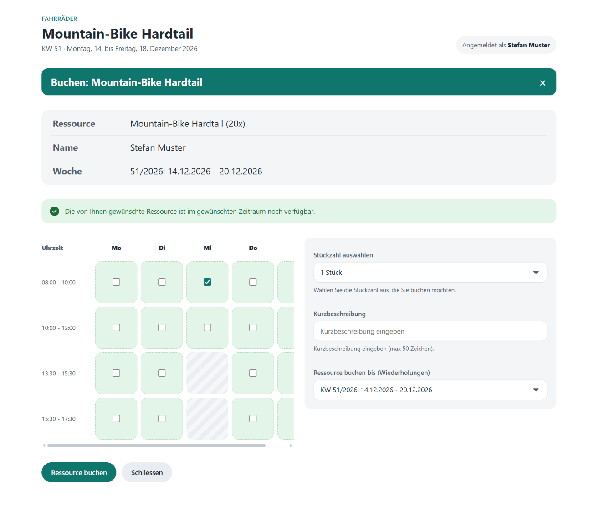
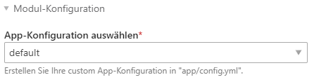
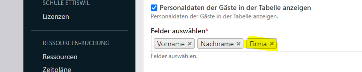
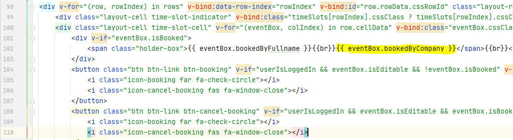

<p align="center">
  
</p>

<h1 align="center">Resource Booking Bundle</h1>

<p align="center">
  <strong>Zimmer, Geräte und andere Ressourcen einfach online reservieren – direkt in Contao.</strong>
</p>

<p align="center">
  
  
  
  
</p>

---

Entstanden ist die Erweiterung an einer Schule, die ein Reservationssystem für ihre Zimmer brauchte. Sie eignet sich aber für alles, was sich in Zeitfenstern buchen lässt: Turnhallen, Sitzungszimmer, Laptops, Beamer oder Fahrzeuge.

Mitglieder sehen eine übersichtliche Wochenansicht, wählen ein freies Zeitfenster und buchen mit wenigen Klicks – auf Wunsch gleich für mehrere Wochen im Voraus.

## ✨ Highlights

| | |
|---|---|
| 📅 **Wochenkalender** | Übersichtliche Wochenansicht mit freien, gebuchten und gesperrten Zeitfenstern. |
| 🔁 **Serienbuchungen** | Ein Zeitfenster gleich für mehrere Wochen am Stück reservieren. |
| 🔢 **Mehrfach buchbar** | Pro Ressource festlegen, wie viele Stück verfügbar sind – ideal für Laptops oder Tablets. |
| 🗓️ **Flexible Zeitpläne** | Eigene Zeitfenster pro Zeitplan, jedes mit eigenen Wochentagen. |
| 🏖️ **Sperrzeiten** | Ferien, Wochenenden oder einzelne Nachmittage sperren – für alle oder nur für bestimmte Ressourcen. |
| 🛡️ **Sicher** | Bestehende Buchungen bleiben geschützt, wenn Zeitpläne geändert oder gelöscht werden. |
| 🎨 **Anpassbares Design** | Eigenes, schlankes Stylesheet ohne Bootstrap. Farben und Abstände über CSS-Variablen. |
| 🌗 **Dark Mode** | Hell- und Dunkelmodus werden automatisch unterstützt. |

## 👀 So sieht es aus

<p>
  <a href="docs/video/demo.mp4">
    
  </a>
</p>

<table>
  <tr>
    <td width="50%"></td>
    <td width="50%"></td>
  </tr>
  <tr>
    <td align="center"><em>Wochenübersicht</em></td>
    <td align="center"><em>Buchungsfenster</em></td>
  </tr>
</table>

## 📦 Installation

Die Erweiterung lässt sich bequem über den **Contao Manager** installieren oder per Composer:

```bash
composer require markocupic/resource-booking-bundle
```

Anschliessend die Datenbank aktualisieren (Contao Manager oder `contao:migrate`).

**Voraussetzungen:** Contao 5.7 oder 6 · PHP 8.3 oder höher

> [!IMPORTANT]
> Beim Update auf eine neue Hauptversion bitte unbedingt die [UPGRADE.md](UPGRADE.md) lesen.

## 🚀 In fünf Schritten startklar

1. **Zeitplan anlegen** – z. B. «Schulalltag» – und darin die Zeitfenster erfassen (z. B. 08:00–08:45). Für jedes Zeitfenster lässt sich wählen, an welchen Wochentagen es gilt. Im Zeitplan legen Sie auch fest, mit welchem Tag die Woche beginnt (Standard: Montag).
2. **Ressourcen-Typ anlegen** – z. B. «Zimmer» oder «Geräte».
3. **Ressourcen erfassen** – z. B. «Zimmer 101». Hier legen Sie fest, welcher Zeitplan gilt, wie viele Stück verfügbar sind, wie weit im Voraus gebucht werden darf und ob Buchungen automatisch bestätigt werden.
4. **Frontend-Modul einbinden** – das Modul «Wochenkalender mit Resourcen-Buchung» auf einer geschützten Seite einfügen.
5. **Mitglieder anlegen** – gebucht werden kann nur mit Login.

> [!TIP]
> Viele Zeitfenster auf einmal anlegen? Das erledigt ein [Konsolenbefehl](#zeitplaene-automatisch) für Sie.



## 🏖️ Sperrzeiten

Unter **Sperrzeiten** erfassen Sie Zeiträume, in denen nicht gebucht werden kann. Eine Sperrzeit gilt wahlweise für alle Ressourcen, für bestimmte Ressourcen-Typen oder für einzelne Ressourcen.

Mit **«Gesperrte Zeiten»** lässt sich die Sperre auf einzelne Wochentage oder Uhrzeiten beschränken:

| Beispiel | Datum | Gesperrte Zeiten |
|---|---|---|
| Sommerferien | 06.07. – 09.08. | *(leer = ganzer Zeitraum)* |
| Wochenende nie buchbar | ab heute, ohne Enddatum | Samstag · Sonntag |
| Freitagnachmittag Hauswartung | ab heute, ohne Enddatum | Freitag 14:00 – 24:00 |

Gesperrte Zeitfenster bleiben im Kalender sichtbar, sind aber schraffiert. Die Bezeichnung der Sperrzeit ist intern und erscheint nur im Backend. Soll im Kalender ein Text stehen, z. B. «Herbstferien», tragen Sie ihn unter **«Hinweis im Wochenkalender»** ein.

## 🎨 Aussehen anpassen

Das Modul bringt ein eigenes, schlankes Stylesheet mit – Bootstrap oder ein anderes CSS-Framework ist nicht nötig. Alle Klassen beginnen mit `rbb-`, Konflikte mit Ihrem Theme sind daher kaum möglich.

Farben, Abstände und Rundungen passen Sie bequem über CSS-Variablen an:

```css
.mod_resourceBookingWeekcalendar {
    --rbb-primary: #8a1538;          /* Buttons, Kopfzeile des Buchungsfensters */
    --rbb-radius: 0;                 /* eckige Buttons und Felder */
    --rbb-cell-bookable-bg: #d4f0d0; /* freie Zeitfenster */
}
```

Alle verfügbaren Variablen stehen am Anfang von [`assets/styles/frontend.scss`](assets/styles/frontend.scss).

### Zusätzliche Mitgliederdaten anzeigen

Soll in der Buchungsübersicht z. B. auch die Firma oder der Wohnort erscheinen, wählen Sie das Feld in den Moduleinstellungen aus und ergänzen das Template, etwa mit `[[ booking.bookedByCompany ]]` oder `[[ booking.bookedByCity ]]`.

<details>
<summary>Screenshots dazu anzeigen</summary>




</details>

> [!NOTE]
> `[[ … ]]` ist kein Contao-Insert-Tag, sondern die Platzhalter-Schreibweise von Vue.js.

<a id="zeitplaene-automatisch"></a>

## ⚙️ Zeitpläne automatisch anlegen

Statt jedes Zeitfenster einzeln zu erfassen, erstellt ein Konsolenbefehl den ganzen Zeitplan:

```bash
php vendor/bin/contao-console rbb:create-slots
```

Der Befehl fragt nach Name, Start- und Endzeit, der Dauer eines Zeitfensters und der Pause dazwischen. Aus **08:00–12:00, 45 Minuten, 15 Minuten Pause** werden zum Beispiel:

```
08:00 – 08:45 · 09:00 – 09:45 · 10:00 – 10:45 · 11:00 – 11:45
```

<details>
<summary>Beispiel-Dialog anzeigen</summary>

```text
Please enter the name of the new schedule.
> Vormittag

Please enter the schedule start time in the format HH:MM. Allowed values are 00:00 to 23:59.
> 08:00

Please enter the schedule end time in the format HH:MM. Notice: The end time must be greater than the start time. Allowed values are 00:00 to 24:00.
> 12:00

Please enter the interval as an integer in minutes.
> 45

Please enter the pause/gap between slots as an integer in minutes (0 = no pause).
> 15
```

</details>

> [!NOTE]
> Der neue Zeitplan ist zunächst unveröffentlicht und muss im Backend noch veröffentlicht werden.

## 🔧 Konfiguration

Die Erweiterung funktioniert ohne weitere Einstellungen. Wer mehr möchte, kann in `config/config.yaml` eigene Konfigurationen anlegen und im Frontend-Modul auswählen:

```yaml
markocupic_resource_booking:
    # Alte Buchungen täglich automatisch löschen (Standard: false)
    purge_past_bookings_with_cron: true
    # Angaben, die im Frontend-Modul zur Anzeige ausgewählt werden können.
    # Achtung: Sie sind für alle eingeloggten Mitglieder sichtbar.
    displayable_member_fields: [firstname, lastname, company, city, phone]   # Standard
    displayable_booking_fields: [title, description]                         # Standard
    apps:
        my_rbb_custom:
            # Beim ersten Aufruf direkt die erste verfügbare Ressource anzeigen (Standard: true)
            auto_select_first_resource: true
            # Zusätzliche Felder im Buchungsformular
            permitted_form_fields: [phone, email]
```

## 🧩 Erweitern mit Events

An mehreren Stellen lässt sich eigener Code einklinken – etwa um vor einer Buchung zusätzliche Bedingungen zu prüfen oder danach eine Nachricht zu verschicken.

| Event | Wann? | Typische Verwendung |
|---|---|---|
| `PreBookingEvent` | vor dem Speichern einer Buchung | eigene Prüfungen, Buchung abbrechen |
| `PostBookingEvent` | nach dem Speichern einer Buchung | Bestätigung senden, Daten weitergeben |
| `PreCancellingEvent` | vor dem Stornieren | Stornierung verhindern |
| `PostCancellingEvent` | nach dem Stornieren | Benachrichtigung senden |
| `AjaxRequestEvent` | bei jeder Anfrage aus dem Buchungstool | Antworten anpassen, eigene Aktionen |

👉 Beispiele und Details: **[docs/EVENTS.md](docs/EVENTS.md)**

## 🔔 Benachrichtigungen

E-Mail-Benachrichtigungen bei Buchung und Stornierung über das [Notification Center](https://github.com/terminal42/contao-notification_center) gibt es als kostenpflichtige Zusatzerweiterung. Bei Interesse melden Sie sich gerne beim [Autor](https://github.com/markocupic).

---

<p align="center">
  Mit ❤️ entwickelt von <a href="https://github.com/markocupic">Marko Cupic</a> · <a href="LICENSE">MIT-Lizenz</a>
</p>
